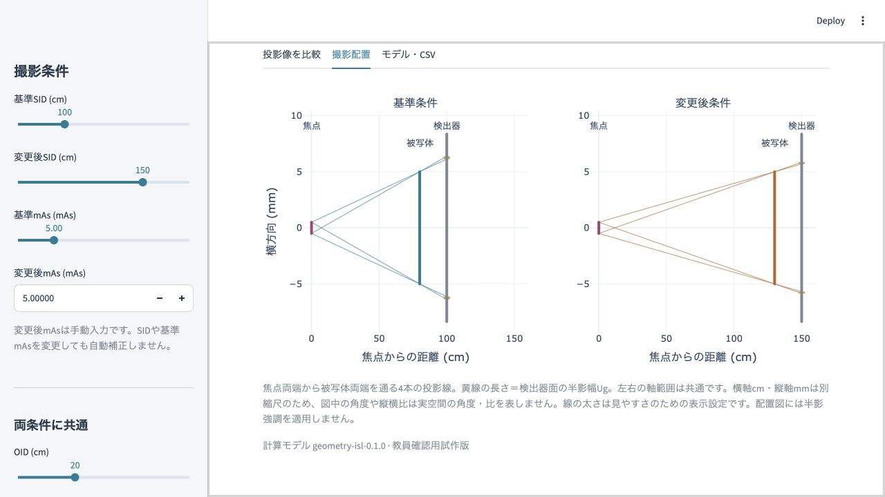
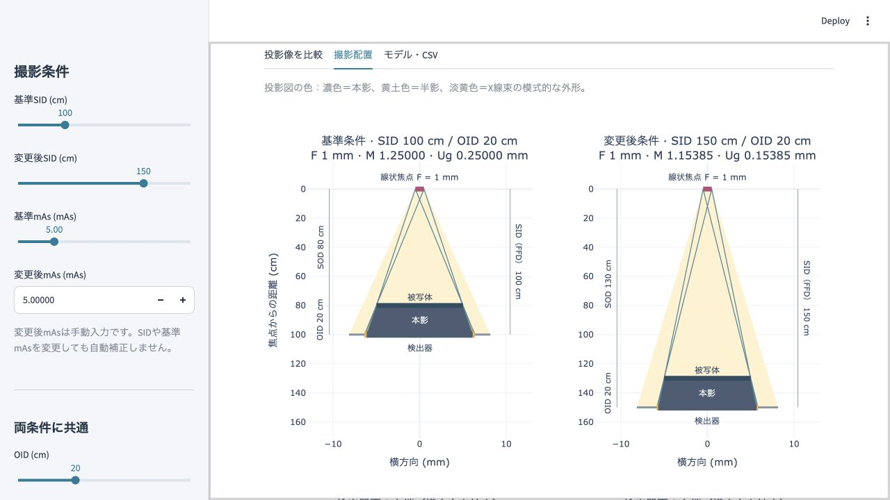

# Veterinary Radiographic Geometry Simulator v0.3.4

獣医放射線学実習用の撮影幾何学・SID変更時mAs補正・フィルム黒化度模式表示ツールです。
v0.3.2を基準に、有限焦点・本影・半影の投影幾何学図を追加しました。v0.3.3の距離だけの図は採用していません。
既存の計算式・黒化度画像・ぼけ表現・mAs操作・CSVを維持しています。
既存の量子ノイズシミュレーターと独立したプロジェクトです。教員確認用で、本番公開はまだ行っていません。

## 起動

対応・検証対象は **Python 3.13** です。このフォルダを作業ディレクトリにして実行します。

```sh
python3.13 -m venv .venv
source .venv/bin/activate
python -m pip install -r requirements.txt
python -m streamlit run app.py
```

Windowsでは`py -3.13 -m venv .venv`で作成し、PowerShellで`.venv\Scripts\Activate.ps1`を使用します。
ブラウザで`http://localhost:8501`を開きます。既存アプリがこのポートを使用している場合：

```sh
python -m streamlit run app.py --server.address 127.0.0.1 --server.port 8510
```

## 操作・出力

画面上部の「実験① SID（FFD）変更」「実験② OID変更」「用語と距離」のタブで切り替えます。SID実験とOID実験の入力・表示設定は独立し、画面を切り替えてもそのセッション内で保持します。

### 実験① SID（FFD）変更（従来の機能）

- SIDは基準・変更後を個別設定。OID、焦点、被写体寸法は両条件で共通です。OIDはSID変更に伴って動かさず、設定した同じ値に保ちます。
- 基準mAsと変更後mAsは独立操作です。初期値はどちらも5 mAs。変更後mAsは0.1〜150を手入力でき、SID変更でも自動補正しません。
- 初期値100→150 cmで、補正倍率2.25・同等線量にする理論mAs11.25を表示します。理論値と手入力値を区別します。
- 「投影像を比較」で共通尺度の四角形・背景と断面を比較します。右端拡大、教育用5/10倍の半影強調、濃淡表示係数1/2/3を選べます。
- 「撮影配置」に、上が線状焦点・下が検出器の投影図を表示します。4本の境界線、本影、左右の半影を色分けし、下段で検出器の右端を拡大します。焦点幅は既存のF設定と連動します。
- 「モデル・CSV」で全入力・両条件の計算値・モデル版・表示設定を2行のCSVとしてダウンロードします。

計算値と表示強調は独立しています。四角形は透過率35％と仮定した減弱体、背景は直接照射領域です。
固定基準100 cm・5 mAsに対する相対線量を逆二乗則で計算し、左右共通の変換で表示します。実際のフィルム特性曲線やDRの表示輝度は再現しません。
実測画像・実機の推奨条件ではなく、同一EIや患者線量を保証しません。自動指導・採点は行いません。
[計算式と仮定](docs/physics_model.md) ／ [検証結果](docs/test_results.md)

### 実験② OID変更

- 基準OIDと変更後OIDをそれぞれ0〜50 cmで独立設定します。初期値は基準0 cm・変更後20 cm。SID100 cm・焦点1.0 mm・被写体実寸法10 mmは固定です。
- 左右それぞれのSOD・拡大率・投影寸法・半影幅を表示します。「撮影配置・距離の関係」を開くと、同じ有限焦点の投影図でも比較できます。OID実験では既存どおりSID100 cm・焦点1 mmが固定です。
- 基準OIDと変更後OIDの投影像を同じ尺度・階調で比較します。半影は従来と同じ計算・描画で、標準・5倍・10倍の表示と右端拡大を選択できます。
- 背景・被写体内部の濃淡は固定し、OIDによる黒化度やmAs補正を扱いません。数値と半影強調倍率は独立です。濃淡固定は幾何学的影響を独立して示す教育上の仮定であり、実機の検出器信号が完全に一定であることを意味しません。
- OID0ではM=1・Ug=0、OID50ではM=2・投影寸法20 mm・Ug=1 mmになります。

### 用語と距離

SID・FFD・OID・SODの英語表記と意味、今回のモデルにおけるSID＝FFD、SOD＝SID−OIDを示します。各実験の設定を読み取り、実験画面と同じ有限焦点・本影・半影の図を左右比較で表示します。新しいSID・OID入力は追加していません。
CSV出力は従来のSID・mAs画面にあります。OID画面専用のCSV機能は追加していません。

## 教員確認用の比較

基準をSID100 cm・5 mAsにし、表示係数と半影倍率を1にして比較します。

| 変更後条件 | 相対線量（基準比） | 背景・四角形の濃淡 |
|---|---:|---|
| 150 cm・5 mAs | 0.44444 | 両方とも薄い |
| 80 cm・5 mAs | 1.56250 | 両方とも濃い |
| 150 cm・11.25 mAs | 1.00000 | 基準と同等 |

SIDが違うため、同等線量でも形の大きさと半影は異なります。CSVの`changed_mas`は手入力値、`theoretical_changed_mas`は補正の理論値です。

## 投影図の読み方と修正前後

- 濃色は本影、黄土色は半影、淡黄色はX線束の模式的な外形です。境界線の検出器交点から各領域を求めます。
- 本影は焦点全体が被写体に隠れる区間、半影は一部が隠れる区間です。不透過体の遮蔽幾何学であり、透過率35％を仮定する従来の黒化度画像とは区別します。
- 焦点幅F・半影幅Ug・投影線は強調しません。既存画像の5/10倍強調は画像にだけ適用します。下段は座標を拡大した表示で、Ugを増幅したものではありません。
- 横方向mmと奥行きcmは別縮尺です。左右は共通尺度ですが、実空間の角度や縦横比は再現しません。X線束の外縁は模式的な照射範囲で、線量・コリメーションを計算しません。
- F＝0では点焦点となり、4本の境界線は2本に重なり、Ug＝0で半影が消えます。

同一条件（SID100/150 cm・OID20 cm・F1 mm・実寸法10 mm）のブラウザ画面です。

| 修正前：v0.3.2 | 修正後：v0.3.4 |
|---|---|
|  |  |

## テスト

```sh
python -m pip install -r requirements-dev.txt
python -m pytest -q
```

v0.3.2の既存197件を変更せず維持し、23件の描画・連動試験を追加した計220件が合格しました。計算、投影線・解析的描画、CSV、UIの入力反映、画面間の入力保持、独立セッションを検証します。
合格は、実機検証や正式な学術的承認を意味しません。

## GitHub・Streamlit Community Cloudへの公開（教員確認後）

1. 本フォルダの**中身**を新しいGitHubリポジトリのルートへ登録します。`app.py`、`geometry/`、`views/`、`docs/`、`tests/`（`fixtures/`を含む）、requirements類、`pytest.ini`、README、`.gitignore`、`.streamlit/config.toml`を含めます。Macでは⌘+Shift+.で隠しファイルを表示できます。
2. `.venv/`、キャッシュ、検証ログ、CSV、旧アプリ、秘密情報は含めません。配布ZIPを新しい場所へ展開すると公開対象だけを取り出せます。
3. Streamlit Community CloudでGitHubを接続し、Create appから当該リポジトリとブランチ、エントリーポイント`app.py`を指定します。
4. Advanced settingsでPython **3.13**を選択し、教員の公開確認後にDeployします。Secretsは不要です。
5. 公開URLで初期値、操作、CSVを再確認します。授業前に起動し、想定人数で負荷・セッション独立性を別途確認してください。

ローカル検証はCloudでの実稼働を保証しません。休止・リソース制約はサービス側の仕様に依存します。
アプリは学生情報・操作履歴を共有ファイルやDBに保存しませんが、ホスティング側のログや統計は別です。
固定のMac絶対パスやサーバーポートに依存せず、外部画像・秘密鍵も必要ありません。

公式資料（2026-11-08確認）：[デプロイ](https://docs.streamlit.io/deploy/streamlit-community-cloud/deploy-your-app/deploy)、[依存関係](https://docs.streamlit.io/deploy/concepts/dependencies)、[Cloudの制限](https://docs.streamlit.io/deploy/streamlit-community-cloud/status)、[リソース・管理](https://docs.streamlit.io/deploy/streamlit-community-cloud/manage-your-app)。
